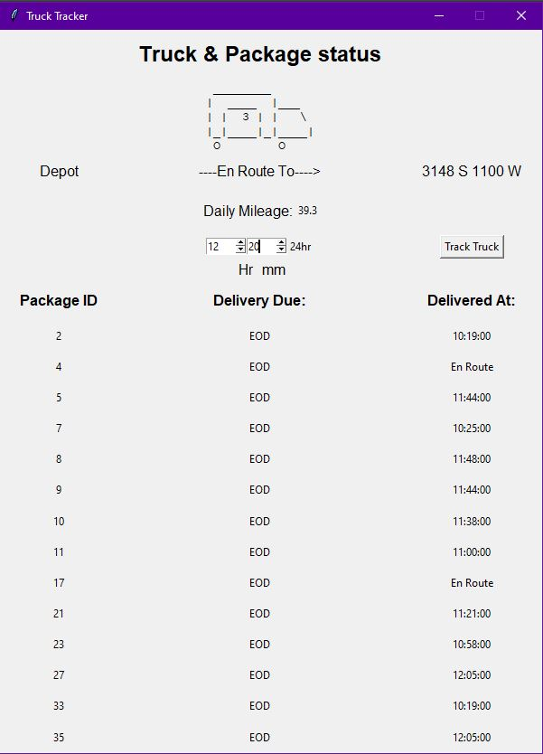
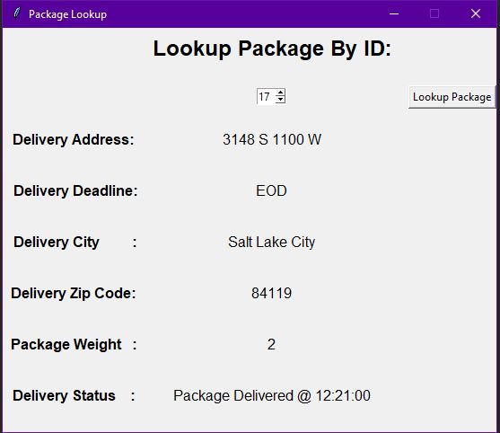
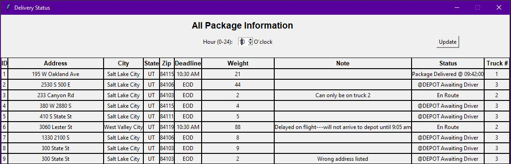

<!-- Main Title & Intro -->
# 📦 Package Routing & Fleet Tracking System 🚚

**Zero-dependency Python logistics engine combining Clarke-Wright route optimization, O(1) direct-access hashing, and 
a live Tkinter MVC dashboard.**


_Hash_Table-001731?style=for-the-badge)

---

A full-stack Python desktop application for fleet routing and real-time package tracking, built entirely from scratch 
without third-party libraries. The system solves a constrained Vehicle Routing Problem (VRP) via the **Clarke-Wright 
Savings Algorithm**, stores and retrieves delivery records in **O(1) constant time** through a custom **Direct-Access 
Hash Table**, and an interactive **Tkinter MVC interface** to audit truck routes, mileage, and package statuses
at any minute of the day.

---
<!-- Quickstart Guide -->
##  Quick Start
1. Clone the repository:
   ```bash
   git clone [https://github.com/](https://github.com/)[your-username]/[repo-name].git
   cd [repo-name]
   ```
2. Run the app:
   ```bash
   python main.py
   ```
   
#### 3. Explore the dashboard interface:
### // Fleet Selection & Delivery Interface
|  <br> Trucks: Enter a 24-hour timestamp (Hr / mm), and click Track Truck to view live hub-to-hub progress, cumulative mileage, and cargo status.|  <br> Package Lookup: Query any individual package record by ID to inspect its destination, deadline, weight, and delivery timestamp. |
| :---: | :---: |

|  <br> Delivery Status: Enter an hour (0–24) and click Update to audit all 40 packages simultaneously|
| :---: |

## // Capabilities & Constraints

* **Automated Route Optimization:** Generates efficient round-trip delivery routes starting and ending at the central
  hub while respecting truck capacity and speed constrain.
* **Time-Travel Fleet & Cargo Inspection:** Query any specific timestamp (`00:00`–`23:59`) to view each truck's progress
  between stops (`Previous Hub` -> `En Route To` -> `Next Hub`), cumulative daily mileage, and individual package 
  delivery timestamps.
* **Operational Edge-Case Handling:**
  * **Driver-to-Truck Ratio Management:** Coordinates 3 delivery trucks across 2 drivers, holding Truck 3 
    (`@DEPOT Awaiting Driver`) until an earlier route finishes.
  * **Delayed Shipment Tracking:** Accurately reflects flight-delayed packages (`DELAYED` / `Awaiting Delayed Packages`)
    until they arrive at the depot.
  * **Mid-Route Corrections:** Dynamically maintains historical package data (e.g., Package #9's initial incorrect 
    address) prior to correction time before updating the manifest mid-shift.
* **Individual Package Lookup:** Search any package by ID with built-in input validation to inspect its destination, 
  deadline, weight, and live delivery status.
  
---
<!-- Structure Details -->
## // Project Structure 

```text
package-routing-system/
├── README.md                 # Project documentation & architectural overview
│
│   # Core Application & Algorithms
├── main.py                   # Application entry point & routing execution
├── gui3.py                   # MVC architecture (Model, Controller, & Tkinter Views)
├── routing_logic.py          # Clarke-Wright Savings algorithm & route optimization
├── direct_map.py             # Custom O(1) direct-access hash table
├── trucks.py                 # Truck domain model & cargo manifest tracking
│
│   # Input Data & Distance Matrices
├── address.csv               # Delivery hub locations & package address mappings
├── distancetable.csv         # Pairwise distance matrix between delivery stops
├── packagefile.csv           # Package manifests, deadlines, weights, & constraints
│
│   # Documentation Assets
└── screenshots/              # GUI captures rendered in this README
    ├── mainmenu.JPG          # Main navigation dashboard
    ├── Dstatus.JPG           # System-wide 40-package status table
    ├── Plook.JPG             # Individual O(1) package lookup window
    └── TPstatus.JPG          # Live truck & cargo route tracker
```
---
<!-- Learning & personal notes -->

## Architectural Design & Trade-Offs

### // Routing Engine:
To balance route optimization with fast execution, the routing engine implements the Clarke-Wright Savings Algorithm
O(n^2 \log n). Exact Vehicle Routing Problem (VRP) solvers scale exponentially and become impractical as stop counts
grow; Clarke-Wright efficiently generates near-optimal, closed-loop routes (starting and ending at the central depot) 
while respecting truck capacity and stop constraints.

* **Evaluated Alternatives:**
  * **Nearest Neighbor:** Greedily selects the closest unvisited stop at each step. While computationally fast, it 
    ignores global route efficiency and frequently causes costly backtracking toward the end of a shift.
  * **Cheapest Insertion:** Builds a route incrementally by inserting single unvisited nodes wherever they add the least
    distance. While distance-aware, it optimizes locally one stop at a time rather than globally merging entire 
    sub-routes based on maximum distance savings.

### // Storage Engine:
Package records are managed in memory using a custom **Direct Map** built without external libraries. By mapping each 
unique `Package ID` directly to an underlying array index, the structure guarantees O(1) constant-time insertion and
lookup.

* **Evaluated Alternatives:**
  * **Standard Hash Map (`dict`):** Supports arbitrary key types and built-in collision handling, though access time can
    degrade to $O(n)$ under heavy hash collisions.
  * **List of Tuples:** Lightweight for very small datasets, but requires an O(n) linear scan to retrieve records by 
    ID.
    
### // Refactoring & Scalability Roadmap

To prepare the system for larger fleets and dynamic daily manifests, the next iteration focuses on three architectural 
upgrades:

* **Object-Oriented Encapsulation:** Replace raw index-based data access with explicit domain methods—such as 
  `get_whole_address()`, `get_street_address()`, `get_deadline()`, and `set_status()`—to decouple internal hash table 
  layout from routing and UI logic.
* **Automated Pre-Routing Load Balancing:** Replace manual cargo grouping with a rule-based assignment engine that 
  evaluates truck compatibility and urgent deadlines (prioritizing timed deliveries over `EOD` packages) before 
  generating routes with Clarke-Wright.
* **Normalized Data Ingestion:** Separate CSV parsing and sanitization from core data structures, stripping 
  non-essential headers and whitespace anomalies up front so malformed file data cannot leak into memory.